# genealogy-agent-skills

Agent skills for researching your family history, for Grok Bot, Codex, Claude and Gemini.

[](https://github.com/rfsbraz/genealogy-agent-skills/actions/workflows/ci.yml)
[](https://github.com/rfsbraz/genealogy-agent-skills/releases)
[](LICENSE)

## Install

Paste this into your agent:

```
Install the genealogy skills by following https://raw.githubusercontent.com/rfsbraz/genealogy-agent-skills/main/INSTALL.md
```

Then say "start a genealogy case", or "Interview me to start my family tree".

"Start a genealogy case" loads `genealogy-mode`, which calls the specialist skills for you. Only `genealogy-mode`, `genealogy-interview` and `genealogy-narrative` load on their own; you can still call any other skill by name. Gemini CLI cannot enforce this, so specialists may load on their own there.

To install by hand instead:

| Host | Commands |
|---|---|
| Claude Code | `claude plugin marketplace add rfsbraz/genealogy-agent-skills` then `claude plugin install genealogy@genealogy-agent-skills` |
| Codex | `codex plugin marketplace add rfsbraz/genealogy-agent-skills` then `codex plugin add genealogy@genealogy-agent-skills` |
| Gemini CLI | `gemini extensions install https://github.com/rfsbraz/genealogy-agent-skills` |
| Antigravity CLI | `agy plugin install https://github.com/rfsbraz/genealogy-agent-skills` |
| Cursor | Clone into `~/.cursor/plugins/local/genealogy`, then reload the window |
| Grok Bot | Connect apps, search "Genealogy", add it (once listed) |
| Claude.ai | Upload each skill zip under Customize > Skills; see [INSTALL.md](INSTALL.md#claudeai) |
| Skills CLI | `npx skills add rfsbraz/genealogy-agent-skills --skill '*'` (Node.js 22.20+; picks the agent's skills folder for you) |
| Anything else | `python install.py --dest <skills dir>` to preview, then add `--apply` |

## How it works



- Every box with a skill name is a `genealogy-<label>` skill. For example, `case-intake` is `genealogy-case-intake`. The "You", `/tree` and `/story` boxes are where you come in.
- A solid arrow is a written handoff: one skill saves its result in the case and the next one picks it up from there.
- The dotted arrow means read only. `genealogy-narrative` reads the case and never changes the evidence.
- `mode`, `interview` and `narrative` are the entry points, and the only skills that load on their own.
- You can still call any skill directly by name, for example "use genealogy-locality-research on this village name".
- Every handoff carries the same envelope: case and question IDs, evidence IDs, findings, uncertainties, next actions and blockers. See the [shared research contract](skills/genealogy-mode/references/shared-contract.md#shared-handoff-envelope).

More diagrams for single parts of the flow are in [docs/workflows/](docs/workflows/).

## Three ways in

### Build a tree by chatting

Say "Interview me to start my family tree". The `genealogy-interview` skill asks one question at a time, keeps what you already told it, and records unknowns, partial dates and corrections without guessing. You can pause and resume, ask to see the tree so far, or say "research now" to hand the first question to the research skills. Everything you report stays provisional until it is checked against records.

### Investigate a question

Say "Find the parents of my great-grandfather" and give what you know, or share a record and ask what it says. `genealogy-mode` opens your case, or starts one, and works out where and when the person lived, which archives hold the records, and which search can tell the possible answers apart. It reads a small batch of records, saves what each one says, and checks every conclusion against the Genealogical Proof Standard before calling it supported. After each step you get a short progress card, and the case keeps the exact next step so you can stop and resume later. Permission to research does not cover sending email, paying for copies or changing a public tree; it asks for those separately.

### Tell a family story

Say "Tell my great-grandmother's life as a story", naming a person already in the case. The `genealogy-narrative` skill writes in a documentary, evocative or novelized style and marks which passages come from records, family memory, inference, historical context or imagined scenes. Stories are saved apart from the evidence and never count as proof.

## Correct a reading or update your tree files

Say "Reread this passage and replace the old reading". Once the new reading is done, `python genealogy.py reread` saves it in place of the old one, keeps the old text in the history, and marks every finding that relied on it for another look. `python genealogy.py project` then writes fact files and tree notes from the case into a new folder, so you edit each finding once instead of in several files. Neither command runs a model. A host that keeps its run in its own record can pass `--external-run` instead of a queue run, and the document queue can rebuild its database from a JSON export with `restore`. See [revisions-and-projections.md](skills/genealogy-mode/references/revisions-and-projections.md) and the synthetic [example](examples/v1.4/WORKFLOW.md).

A finding checked against its cited source can be saved as `source_supported`, with its scope and limits, before a full proof review. Only a full review makes it `supported`.

## Bring in an existing tree

Say "Import my GEDCOM file", or run `python genealogy.py gedcom check tree.ged` first. The check lists possible duplicates, impossible dates (death before birth, lifespans over 120 years, days that don't exist) and parents born after their children or children born after a parent's death. `python genealogy.py gedcom import tree.ged --out case.json` then opens a new case from the file. Every person, fact and link comes in as a provisional claim, cited to the GEDCOM file, with each check issue saved as a task. Nothing from the tree counts as proof until it is tested against records. When findings are reviewed, `python genealogy.py gedcom export case.json --out reviewed.ged` writes only the supported and source-supported claims, each with its sources, for other genealogy programs, plus a report of what GEDCOM could not carry. None of these commands runs a model or uses the network.

## Commands

The `/tree` and `/story` commands are shortcuts to the same two skills. You can always just ask in plain words instead.

| Host | Tree | Story |
|---|---|---|
| Claude Code | `/genealogy:tree start` | `/genealogy:story PERSON --style documentary` |
| Cursor | `/tree start` | `/story PERSON --style evocative` |
| Gemini CLI | `/tree start` (or `/genealogy.tree` if another extension uses the name) | `/story PERSON --style novelized` |
| Others | Type `/tree start` as a normal message | Type `/story PERSON` as a normal message |

`/tree` takes `start`, `add`, `review`, `correct`, `pause`, `resume` or `research`. `/story` takes a person and an optional `--style documentary`, `evocative` or `novelized`. See [docs/workflows/modes.md](docs/workflows/modes.md) for how the modes fit together and [chat-commands.md](skills/genealogy-mode/references/chat-commands.md) for the full list.

## Privacy

Your case files stay where you keep them, on your own computer or storage. The helper scripts work offline and send nothing anywhere. Your agent still sends what you share in the chat to its model provider, so check that provider's settings for sensitive family details.

Never commit family data to this repository or a fork of it. That covers names, dates, places, record references, images and transcriptions from real research. Tests and examples use made-up people only; see the data rule in [CONTRIBUTING.md](CONTRIBUTING.md#data-rule).

## About

Version 2.1.0 of the skill suite: 27 skills (26 for everyday use, plus a maintainer evaluation skill) that plan a family-history investigation, find sources and archives, read records and handwriting, resolve identities and write cited conclusions. <!-- x-release-please-version -->

Start with the `genealogy-mode` skill. The installer and helper scripts need Python 3.10 or later, standard library only. Building manuscript reading packets with `genealogy-read-manuscripts` also needs Pillow (`pip install pillow`); summarizing their reports does not.

## Checks

```sh
python validate_package.py
python scripts/build_manifest.py --check
for test in tests/check_*.py; do python "$test" || exit 1; done
python tests/test_repo.py
python scripts/privacy_scan.py
```

CI runs the same checks plus an installer run; see [CONTRIBUTING.md](CONTRIBUTING.md#checks). Release history is in [CHANGELOG.md](CHANGELOG.md). See [docs/VALIDATION.md](docs/VALIDATION.md) for what has and has not been tested, and [docs/TRANSCRIPTION-WORKFLOW.md](docs/TRANSCRIPTION-WORKFLOW.md) for the transcription flow.

## Contributing

Contributions are welcome. Read [CONTRIBUTING.md](CONTRIBUTING.md) before opening a pull request, and follow the [Code of Conduct](CODE_OF_CONDUCT.md). Report security problems as described in [SECURITY.md](SECURITY.md), not in a public issue.

## License

[MIT](LICENSE)
