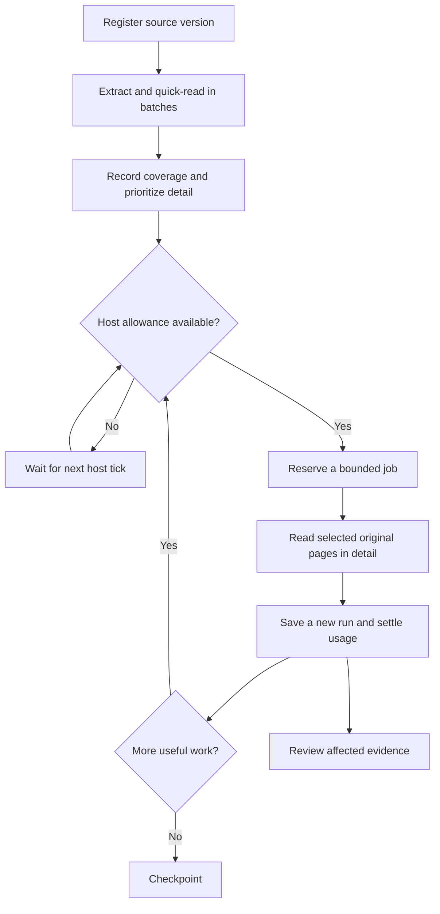

# Quick reading, detailed reading and progressive coverage

Version 1.1 adds three skills: `genealogy-transcribe-quick`, `genealogy-transcribe-detailed` and `genealogy-document-processing`. From v1.4.1, `genealogy-read-manuscripts` uses four distinct methods in separate contexts; the same model may perform all four. Model sameness is not a fallback trigger. All three additions are country-neutral.

In v1.4.2, inspect pre-made enlarged views before dispatch, preserve every comparison sample's page identity, and supply D with both context and close-ups. C's whole-line reading requires a character audit against detail and coordinator comparison with A/B. See the [packet guide](../skills/genealogy-read-manuscripts/references/packet-helper.md).

In v1.4.3, derive crops from pinned full pages and record actual per-target visual checks before `dispatch` releases inputs. Confirm the intended complete phrase as well as coordinate correspondence. B receives a marked position and preceding word; deduplicated neutral views retain source identities. Stop when source resolution is exhausted; another context does not add pixels. Packet schema 1.2 is separate from the unchanged case schema and SQLite ledger.

| Layer | Purpose | Evidence of completion |
|---|---|---|
| Extraction | Obtain machine-readable text where available | Actual tool output and page coverage; no claim of human/agent reading |
| Quick transcription | Bounded entry sweep, complete relevant fields, document map and leads | Saved text/abstracts, actual method, uncertainty and exact pages/regions |
| Detailed transcription | Diplomatic reading and focused uncertainty resolution | New artifact, method/readers/rounds, coverage and unresolved spans |
| Processing ledger | Track versions, runs, coverage and queued work | SQLite records, artifact hashes, budget reservations and usage |

Quick mode still produces text. A section summary is labelled as an abstract rather than a full transcription. Detailed handwriting mode uses local feature analysis, same-hand comparison, complete-line recognition and contextual decoding in isolated method contexts. When fresh contexts are unavailable the four-method panel stops, and the reading falls back to a blind plus context double reading that is labelled as such. Neither mode automatically proves a genealogical claim.

## Default flow for a large document

This flow is implemented as skill instructions plus a local queue/ledger CLI. It is not a running model service or a timer. A host must execute the claimed jobs and grant real capacity. The example schedule is disabled.

## Example status

A hypothetical 250-page document can show: 250 pages extracted, 80 quick-full, 12 detailed-full, 238 still lacking full detail. These counts overlap. A page can be fully transcribed with one uncertain name, so processing level and uncertainty are separate fields.

Keep long transcripts as artifacts. Show a compact overview with page references by default. The database stores pointers and hashes, not PDF/image bytes. Originals may remain in a document management system (for example Paperless-ngx) or the existing source repository.

## Integration with an existing research repository

- Keep existing DOC-IDs, `sources/`, SHA-256 manifests and transcript files.
- Register each exact source version; import established old reading scope through `import-run`, with original dates/methods and a stable import key.
- Add `processing_run_id` and `source_version_id` to observations in `data/facts/<DOC-ID>.json` when useful. Preserve older observations and rationale when readings change.
- Store new transcripts in separate run/version paths. Do not overwrite a quick result with a detailed result.
- Keep the live SQLite database private and out of ordinary Git commits. Export intentional JSON snapshots for audit/versioning; apply publication rules separately.
- Keep family-tree truth in the existing canonical research model. This is a processing ledger, not a second genealogy database.

## Running it

Start with `skills/genealogy-document-processing/references/cli.md`. The CLI supports initialization, registration, historical import, planning, explicit allowance windows, atomic claiming, result settlement, status, cancellation of queued jobs, JSON export and restore from an export. Python 3.10+ is sufficient; there are no third-party dependencies for the ledger.

A host can tick every few hours and reserve work only when its allocation permits. Model/image token estimation must include all readers and follow-up rounds. The helper cannot inspect ChatGPT plan quota. Unknown usage is labelled estimated; overruns remain recorded. Actual provider caps, cost limits, source access and timer execution are host responsibilities.

Run `python tests/check_document_queue.py` to exercise the local synthetic ledger tests. They do not measure handwriting accuracy, real 250-page throughput or live scheduling. No personal records were migrated or read for this update.

For an existing v1 installation, the installer still refuses conflicting files. Install into a separate staging directory, review changes and replace the intended skill directories through your host's normal update process. Preserve local edits and avoid registering duplicate skill names.

## v1.4 corrections

An initial answer does not end a quick entry sweep: inspect the other principal, parents, ages, continuation and margins. Freeze a detailed reread before comparing it to earlier readings. The SQLite `--reread-reason` workflow remains unchanged; after the actual run, use `genealogy.py reread` to replace a current observation while preserving its history and flagging dependent claims. Generate facts and tree notes through `genealogy.py project` instead of hand-maintaining three copies. See [the operational guide](../skills/genealogy-mode/references/revisions-and-projections.md).
