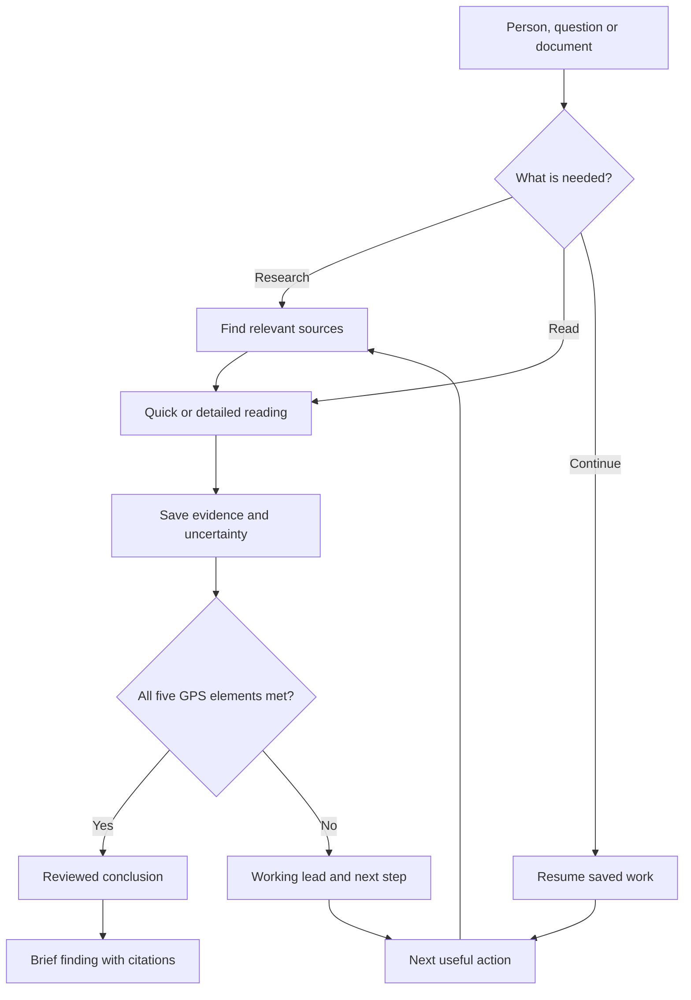

# Everyday research flow

Start with a person, a question or a document. The agent either discovers sources, reads supplied material or resumes the saved next step. It saves evidence and uncertainty, then evaluates the five GPS elements before accepting a conclusion. If the evidence is incomplete, it preserves a working lead and chooses the next useful action. The user receives a short finding with citations; the complete audit remains available.

