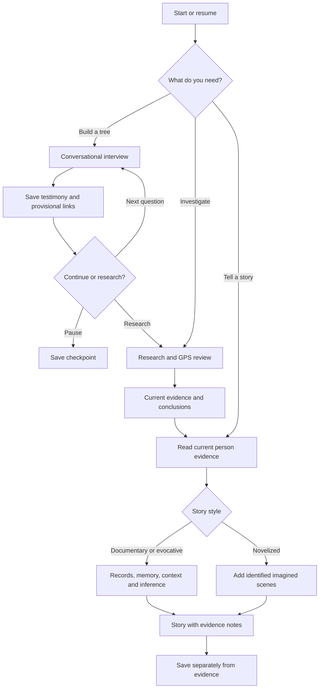

# Interview, investigation and story modes · v1.3

The user can switch modes at any time. Save the interview checkpoint before research or storytelling. Interview claims remain provisional until reviewed; a story can honestly describe records and recollections before a GPS conclusion exists. Imagined scenes stay outside the evidence graph. Contextual sources are consulted and cited for the story, not treated as proof of individual participation.
